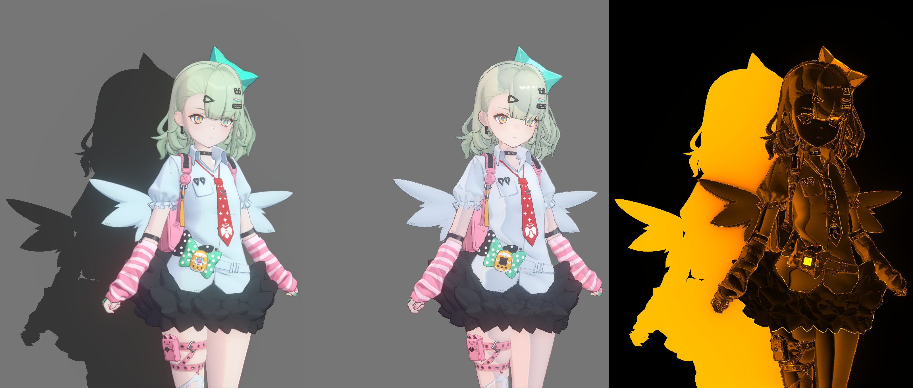
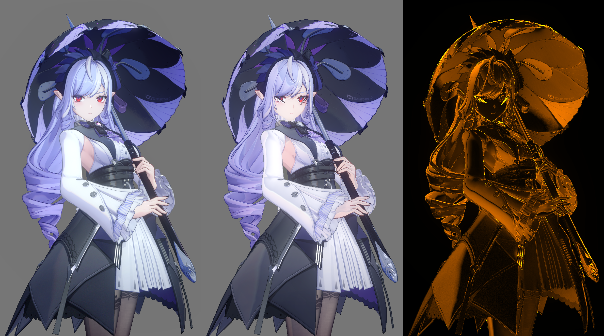

# ZZZ 角色渲染框架：Unity URP 逆向重实现

在 Unity 6 / URP 17 中重写《绝区零》的角色渲染。同一套源码驱动千夏和薇薇安，按 Surface、Face、Eye、Outline、HairShadow、Output 六个模块组织。

> 独立研究项目，与 miHoYo / HoYoverse 无关。仓库不包含游戏模型、贴图、动画、反编译 Shader、LUT 或捕获数据。

## English abstract

A Unity 6 / URP 17 reimplementation of the character rendering in *Zenless Zone Zero*, reconstructed from GPU frame captures. Six modules share one framework; two characters use it through different material profiles and skeleton mappings. All shaders and C# are original reimplementations, and no game assets are included.

## 效果

*左为捕获帧的源角色输出，中为 Unity 当前实现，右为逐像素差异热图。*

*同一比较流程下的薇薇安角色层。*

固定机位、固定姿态、8-bit sRGB 条件下，角色层平均 sRGB 距离为千夏 0.091、薇薇安 0.094。

## 代码阅读指引

`unity/` 收录 22 个源码文件，2,664 行。

| 想看的内容 | 入口 |
| --- | --- |
| 表面、服装、头发 | [ZZZCharacterSurface.shader](unity/Shaders/ZZZCharacterSurface.shader) → [ZZZSurface.hlsl](unity/Shaders/Includes/ZZZSurface.hlsl) |
| 脸、眉、睫毛 | [ZZZCharacterFace.shader](unity/Shaders/ZZZCharacterFace.shader) → [ZZZFace.hlsl](unity/Shaders/Includes/ZZZFace.hlsl) / [ZZZFaceMath.hlsl](unity/Shaders/Includes/ZZZFaceMath.hlsl) |
| 眼球与覆盖 | [ZZZCharacterEye.shader](unity/Shaders/ZZZCharacterEye.shader) → [ZZZEye.hlsl](unity/Shaders/Includes/ZZZEye.hlsl) |
| 描边 | [ZZZCharacterOutline.shader](unity/Shaders/ZZZCharacterOutline.shader) → [ZZZOutline.hlsl](unity/Shaders/Includes/ZZZOutline.hlsl) |
| 发影 | [ZZZCharacterHairShadowMask.shader](unity/Shaders/ZZZCharacterHairShadowMask.shader) → [ZZZHairShadow.hlsl](unity/Shaders/Includes/ZZZHairShadow.hlsl) |
| 调色与高亮 | [ZZZCharacterOutput.shader](unity/Shaders/ZZZCharacterOutput.shader) → [ZZZCharacterOutput.hlsl](unity/Shaders/Includes/ZZZCharacterOutput.hlsl)、[ZZZCharacterOutputFeature.cs](unity/Runtime/ZZZCharacterOutputFeature.cs) |
| 运行时输入 | [ZZZCharacterInputs.cs](unity/Runtime/ZZZCharacterInputs.cs) |
| 材质面板 | [ZZZCharacterShaderGUI.cs](unity/Editor/ZZZCharacterShaderGUI.cs) |

建议按 输入 → Surface → Face / Eye → Outline / HairShadow → Output 的顺序读。每个模块先看 Shader 的属性块，再看 HLSL 入口函数，最后对照 [管线文档](docs/pipeline.md) 的公式。

## 文档

- [方法：从 GPU 证据到可读 Shader](docs/methodology.md)
- [管线与模块契约](docs/pipeline.md)
- [千夏案例](docs/case-qianxia.md)
- [薇薇安案例](docs/case-vivian.md)
- [已知缺口](docs/limitations.md)
- [Unity 源码说明与接入顺序](unity/README.md)

## 使用条件

源码面向 Unity 6000.0.83f1、URP 17.0.4、Linear 色彩空间和 RenderGraph。仓库不附带材质、控制图、主图、Matcap 数组和 LUT，不能直接运行；把 `unity/` 放进自己的 URP 工程后，按 [Unity 源码说明](unity/README.md) 接入。

## 许可

代码以 MIT 许可发布，见 [LICENSE](LICENSE)。《绝区零》名称、角色和相关素材的权利归 miHoYo / HoYoverse 所有。对照图仅用于说明研究方法，如权利人要求可移除。详见 [NOTICE](NOTICE.md)。
