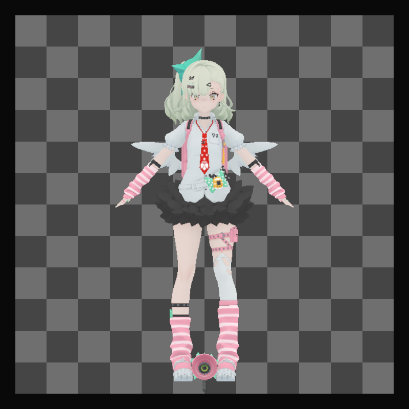
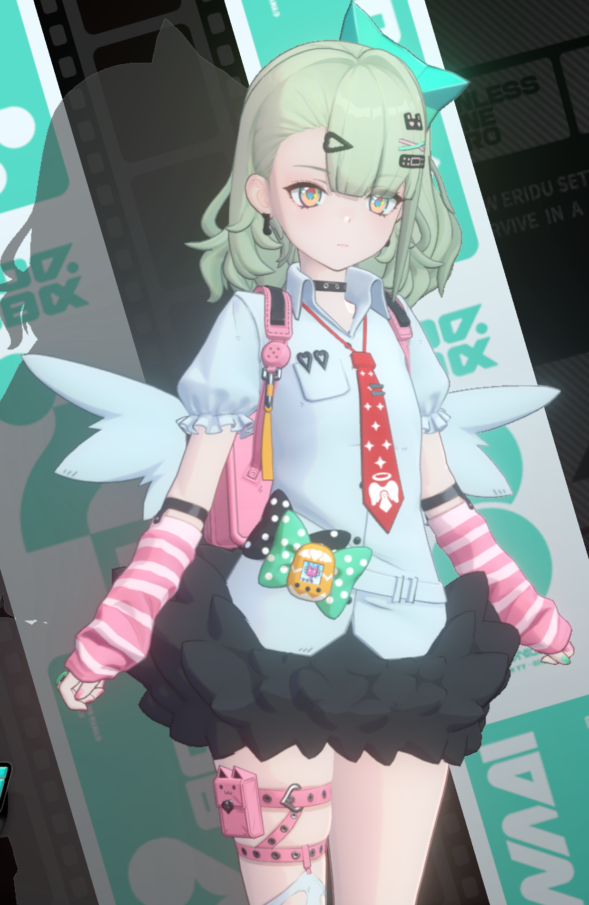
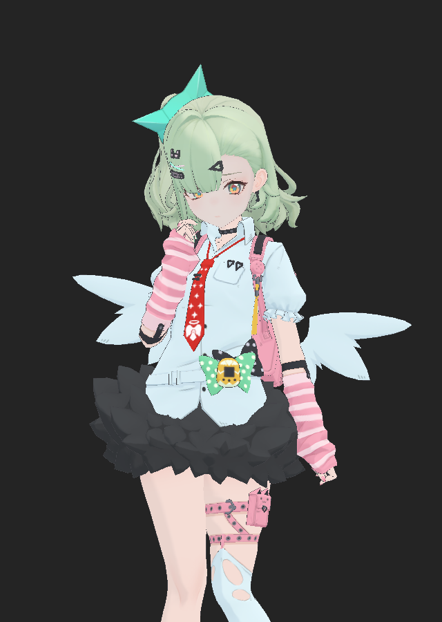

# 案例：千夏 R0–R9

千夏案例的重点不是单张画面，而是把角色渲染拆成可独立验证的模块，再收拢成一套可复用框架。

## 范围

- 只处理常服角色的可见表面、脸、头发、眼睛、描边、发影和最终输出。
- 不还原 UI、完整动画状态机、战斗特效或其他角色。
- 固定姿态、机位和待机相位作为受控验证条件。
- 交付是可编辑几何、具名参数化 Shader、Unity 源码和验证入口，不是把源画面当贴图播放。

## R0：输出边界

R0 建立“源角色 MRT → 线性 HDR 检查点 → 展示输出”的边界：

- 角色层使用 `R16G16B16A16_SFloat`、`sRGB=false`、无 mip、1 sample。
- 检查点做非对称 UV、负值和 HDR 的恒等拷贝。
- 展示侧单独做曝光、对比度、饱和度、HDR 压缩和亮部滤波。
- 源角色 MRT 到最终输出的完整生产者没有恢复，登记为缺口。

数值：颜色最大误差约 `7.8e-4`，Alpha 误差 0；真实角色覆盖 58,331 像素，角色层与拷贝层逐像素误差 0。

*R0 边界接入后的 Game View 记录。*

## R1：脸、眉、睫毛

把脸部拆成三个消费者：脸主槽、独立眉毛、脸内睫毛 / 眼线。

- 角度镜像 UV、控制图 R 的边界中心、控制图 G 的采样选择与带宽分别求值。
- 顶点 `COLOR.b` 低两位是色板选择，不是部位编号。
- 三色权重（白 / 浅 / 暗）不能压成单一 dark 权重。
- 视距色板单独作为 Feature。

验证：45 组 GPU / CPU 对照，最大误差 `5.549e-5`；转灯、转头后目标区域有响应，恢复误差 0；Play 帧推进时头部轴写入实际材质槽。

学习精简版从 913 行减到 355 行（-61.1%），删除项有逐项对照；不宣称完整源算法。

## R2：眼球与覆盖

- 顶点 `COLOR.r` 作为整数编码查 16×16 色表，再插值。
- RGB 乘 2，Alpha 不乘 2；覆盖在输出端只预乘一次。
- 保留亮度 / 法线幂响应。

验证：39 组对照，最大误差 `1.19e-7`；贡献、透明状态、生命周期和 Play 分别记录。

## R3 / R4：身体、服装与头发

- `N.RG` 重建切线法线，`N.B` 作色调偏置。
- `M.R` 按 `.2/.4/.6/.8` 选择五套色板。
- 七段色阶 + 半角高光。
- 头发复用同一核心，差异在材质 Profile 和色板。

验证：转灯改变 14,084 像素，强度变化 50,983 像素；恢复后差异超过 0.001 的像素为 0。头发高光单项 699 像素，恢复差异 0。

## R5：Matcap

- 视空间法线查表，Body1 使用已验证的 `Eff_MatCap_091`。
- Body2 保持关闭，未闭合的 019 视图不作生产默认。
- 只恢复有界叠加，不恢复全数组与折射。

## R6：描边

- 4 个视空间描边外壳（UV1 平滑法线），同骨架蒙皮。
- Face Morph 单独同步。
- 眼球 / 睫毛描边槽关闭。
- 宽度按投影深度分三段，再乘视口修正。

## R7：发影

- 源 `Summer_HairShadow` 几何保留裁剪空间偏移，再叠加参考画幅像素偏移。
- 只由脸主槽低位 Stencil 接收。
- 一次乘色后清标记，避免重复变暗。
- 跟随动画头部；源码中没有光向输入。

## R8：输出

- LogC LUT 调色、亮部预滤波、三尺度高亮图集与分段响应。
- 高亮按 0.3/0.3/0.26/0.15 还原后加到调色结果上。
- 角色层使用独立相机 / RenderTexture，背景不进入这条链。
- 源角色 MRT 到最终输出的缺失生产者没有恢复。

## R9：整合

R9 没有独立 Shader。它是唯一主场景、既有输入组件、验证入口和参数校准的整合。单场景 `Qianxia.unity` 保留待机、R0 检查点和全部模块消费者；实验使用内存 PreviewScene 或可恢复开关。

*源常服角色的参考裁切，保留原背景与颜色。*

*当前参数下的角色层。目标与源的姿态、机位尚未精确配准，这张图不能当作源帧一致的证明。*

## 两角色统一

2026-11-08 把千夏和薇薇安统一到 `unity/` 目录下的同一套源码。证据是两帧共用同一组 GPU Shader：

| 用途 | Shader 前缀 |
| --- | --- |
| 表面 | `a24c103a` |
| 头发变体 | `050d63a2` / `1bccd522` |
| 脸 | `3969ce67` |
| 眼 | `720a454f` |
| 身体描边 | `a9f95d03` |
| 脸部描边 | `dcab6417` |
| 发影 | `c07b54c6` |
| 合成 | `fbb07bad` |
| 最终输出 | `6443f79d` |

合成 Pass 的 32³ LogC LUT 在两帧中字节相同。因此统一框架有源证据支撑，角色差异只在材质 Profile 与骨架适配。

统一过程中修正的实际错误：

1. 缺少合成 LUT 调色，是两角色整体色偏的主因；CPU 模型对源 Draw 的平均误差 0.0015。
2. 千夏导入链相对源网格 X 镜像，根节点 `localScale.x=-1` 纠正。
3. 捕获线性色板写入 `Color` 被二次 sRGB 解码，安装器统一写 `.gamma`。
4. 脸部改为源式 `albedo × (0.96 × 色调 × 光色 + 环境 cb0[2])`。
5. 眼 / 描边补 `_FORWARD_PLUS` 变体，修复主光为零。
6. 移除薇薇安手调艺术补偿；千夏补齐腮红、脸部 / 眉 / 腮红描边、发影遮罩。
7. 千夏相机改为直出透视（FOV 24°），机位与主光由待机最佳相位的躯干刚体拟合换算，残差 1.7 cm。

## 统一后测量

用源顶点池把当前网格摆到捕获姿态、以源投影相机渲染，与最终角色输出逐像素比较（8-bit sRGB）：

- 千夏平均距离 `0.143 → 0.091`；
- 薇薇安 `0.157 → 0.094`；
- 按材质槽统计的主要区域亮度比 `0.92–1.07`。

这是固定帧、固定姿态、固定画质的测量，不是任意条件下的一致性证明。
